[English](README.md) · [Русский](README.ru.md) · [Українська](README.uk.md)

# Pulsar

The device's pulse on screen: a floating load monitor and live real-time charts, remote/keyboard button bindings, gestures, sensors, AFR, a dock panel and an optional AI assistant — for phones and Android TV boxes.

Pulsar is the device's pulse on screen: a floating load monitor and live real-time charts. Plus — remote buttons, gestures, mouse and sensors turned into quick actions: open an app, change the volume, switch the screen frame rate to match the video, and much more. Works on phones and TV boxes alike: remote, gestures, air mouse. No ads, no purchases.

⭐ If the app is useful, please star this repository: it costs nothing and helps other people find it.

## Download

**Version 2.3.** [Pulsar-2.3.apk](https://github.com/drugoj00/pulsar/releases/latest) (Assets) · [Releases](https://github.com/drugoj00/pulsar/releases)

SHA-256: `89956af91c79033112bb705359ed9f25745cadd95798c14e3853d09178583940`

Not on Google Play: download the APK here. Android may warn about installing from an unknown source.

## What's new in 2.3

- Timer repeats go up to 150, so the slider sets any number easily

## Features

- **Monitor.** A floating panel with CPU, RAM, temperature, battery, network, disk — any corner, a row or a column, draggable, your own colour and transparency; it steers clear of the status bar and navigation buttons/bar on any side.
- **Charts.** A separate floating window with live charts of the same readings, movable and resizable.
- **Interval timer.** Chains of timers: each has its own phases (work, rest…) and repeats, e.g. 30 s – 10 s × 15, then 2:10 – 0:15 – 2:00 – 0:10 × 3. Phase times, get-ready and repeats are set with counters (any number of seconds from 1). Every signal switches on and off separately; the program and each timer can have their own sound, volume and countdown beep pitch; sticks any number of seconds before the work ends; voice prompts, vibration, screen stays on. A graph of the program in a floating window and as a tile in the monitor; keeps running after the device reboots.
- **Buttons.** Bind a single, double or long press of any remote, keyboard, air-mouse or mouse button to an action: launch an app, Home, Back, Recents, volume, media keys, a multi-step macro, a shell command (root or ADB), a TCP/HTTP request, a screenshot, reboot, lock the screen and more.
- **Gestures.** Accelerometer gestures (shake, flip, tilt, spin) work without root or ADB. On-screen gestures, air mouse and mouse (right/left button held + move) need root or ADB.
- **Triggers.** Rules "event → action" (boot, idle for a set time, app opened, screen off), 25 ready-made gesture/sensor templates to pick from, fields editable before saving.
- **AFR (frame-rate switching).** The screen switches to the playing video's frame rate on its own and switches back after — for TV boxes.
- **Dock panel.** A strip of favourite apps that follows the screen on its own (shown over Pulsar and the home screen, hidden in other apps), its own background and transparency, icon order and alignment, reorder icons by holding (mouse/finger) or from the remote (hold OK + arrows).
- **App lock.** Chosen apps only open with a PIN code (4–12 digits).
- **Devices.** Connect over root or wireless ADB (Android 11+), reconnects on its own.
- **Console.** A shell terminal with any command right inside the app, voice input (microphone).
- **Assistant (AI, optional).** "Suggest" — describe in words what should happen, the app proposes a binding or rule. "Explain" — paste a ready technical command, the app tells you what it does (nothing is run). Works offline for common cases; for the rest, pick a service and paste your own key (Claude, OpenAI, Gemini, DeepSeek, Groq, OpenRouter, Mistral — Gemini, Groq, DeepSeek and OpenRouter give a free tier) or run it fully free on your own computer (Ollama / LM Studio).
- **Anti-tamper.** A modified copy re-signed with someone else's key disables part of its features on its own (obfuscation + signature check at startup).
- **Error log.** Crashes and failed bindings are logged on their own; send to support with one button, the email with the file attached is ready.
- **Backup.** Export and import all settings to a file.
- **Settings.** Theme (auto, light, dark), language (Russian, Ukrainian, English).
- **Free.** No ads.

## Requirements

Android 7.0 or newer. Works on phones and on Android TV / TV boxes (remote, gestures, air mouse). Without root: wireless ADB (Android 11+) unlocks most features; with root, ADB is not needed.

Only one accessibility service can intercept button presses at a time. If another remote/button/gesture app is already installed, Android decides which one actually gets the key events — not always the one enabled last. If buttons or gestures stop working after installing Pulsar (or the other way round), open Settings → Accessibility and turn one of the two services off by hand.

## Screenshots

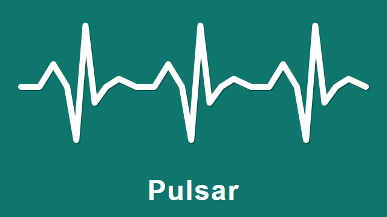

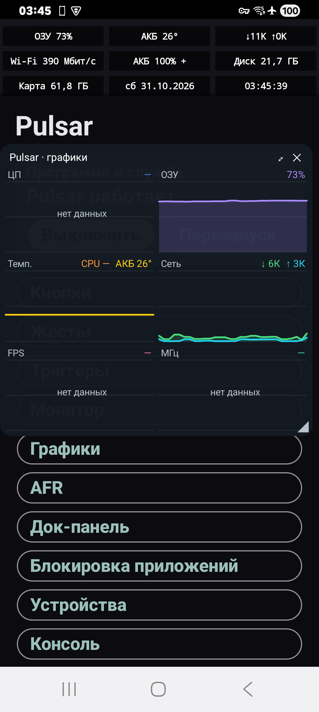 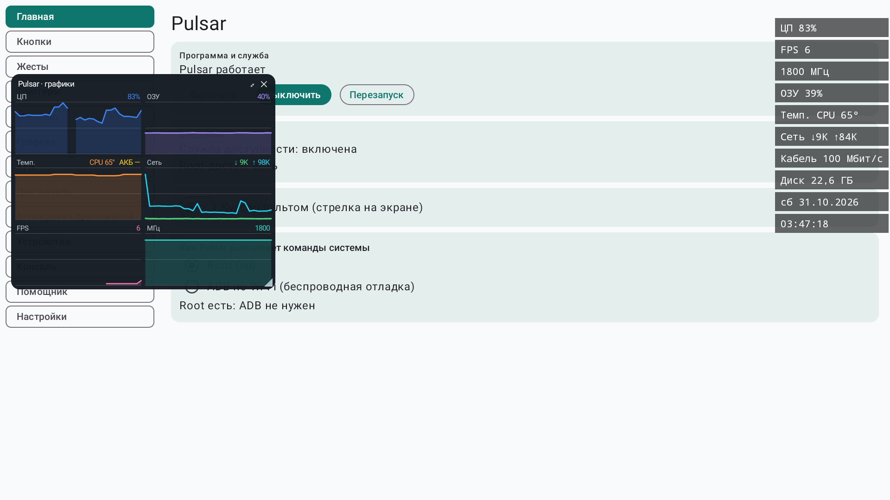

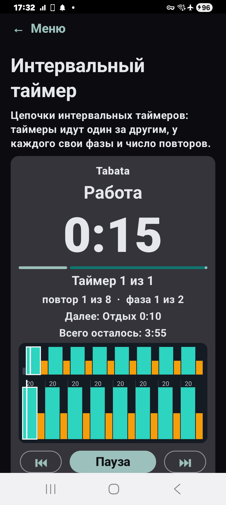 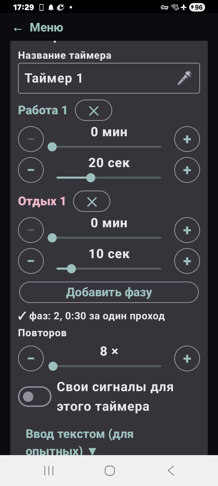 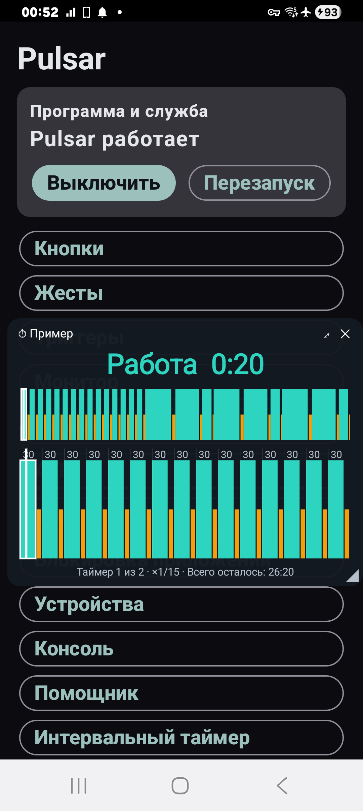 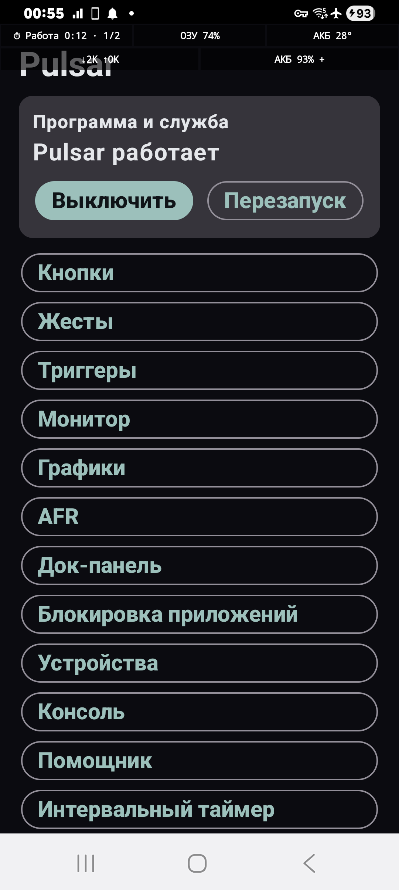

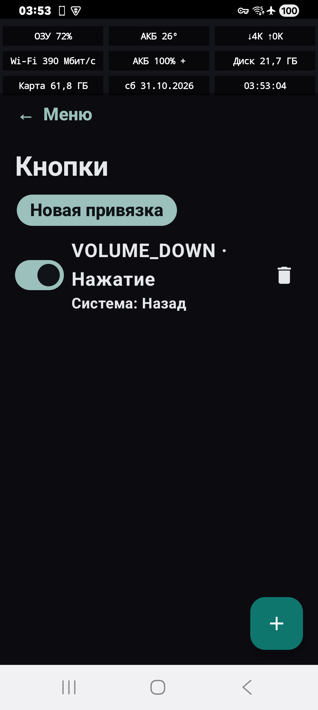 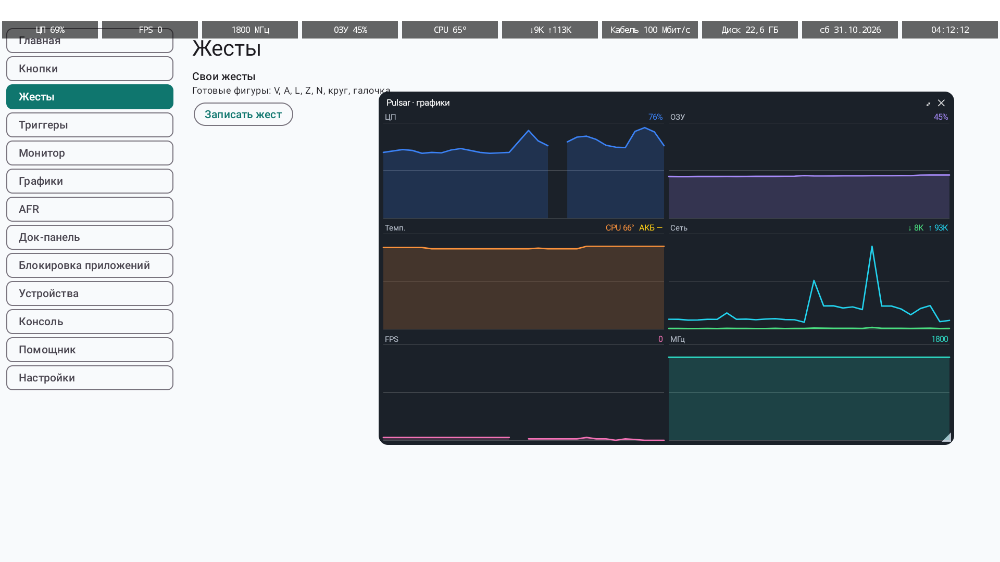 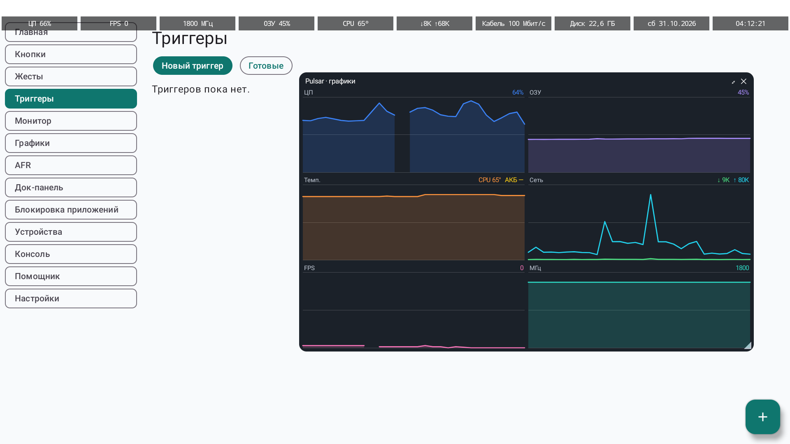 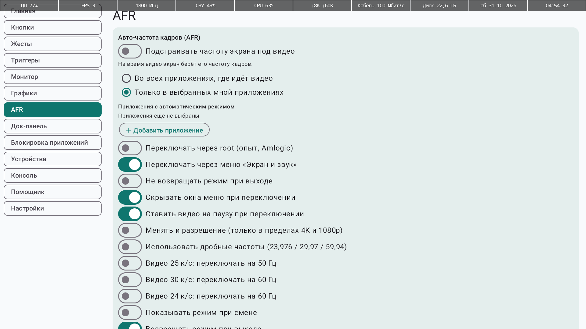 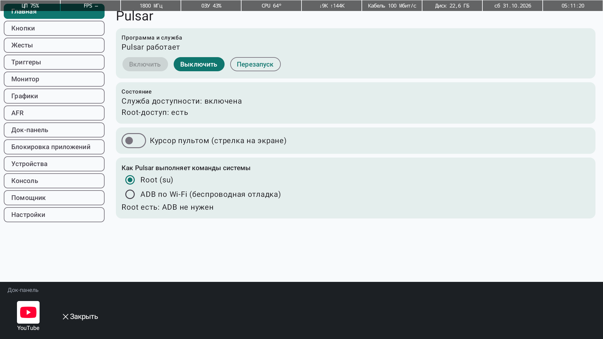 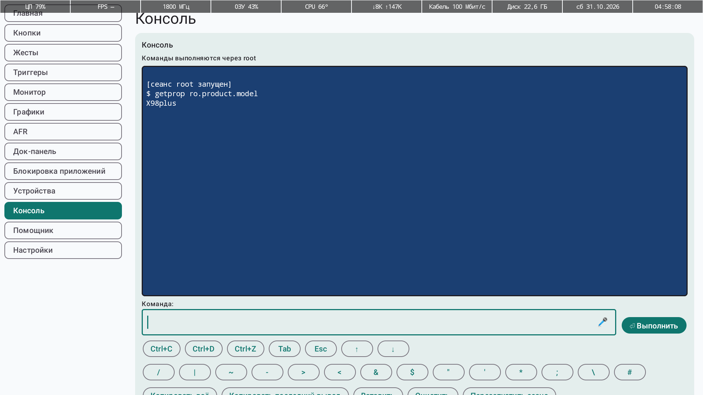

