[English](README.md) · [Русский](README.ru.md) · [Українська](README.uk.md)

# Pulsar

Пульс устройства на экране: плавающий монитор нагрузки и живые графики в реальном времени, привязки кнопок пульта/клавиатуры, жесты, датчики, AFR, док-панель и помощник ИИ по желанию — для телефонов и ТВ-приставок на Android.

Pulsar — это пульс устройства на экране: плавающий монитор нагрузки и живые графики в реальном времени. А ещё — кнопки пульта, жесты, мышь и датчики, превращённые в быстрые действия: открыть приложение, поменять громкость, переключить частоту экрана под видео и многое другое. Работает и на телефоне, и на ТВ-приставке: пульт, жесты, аэромышь. Реклам и покупок в программе нет.

⭐ Если программа полезна, поставь репозиторию звезду — это бесплатно и помогает другим её найти.

## Скачать

**Версия 2.3.** [Pulsar-2.3.apk](https://github.com/drugoj00/pulsar/releases/latest) (Assets) · [Все релизы](https://github.com/drugoj00/pulsar/releases)

SHA-256: `89956af91c79033112bb705359ed9f25745cadd95798c14e3853d09178583940`

В Google Play программы нет: скачивай APK здесь. Android может предупредить об установке из неизвестного источника.

## Что нового в 2.3

- Число повторов таймера до 150, ползунком легко поставить нужное число

## Возможности

- **Монитор.** Плавающая панель с показателями (ЦП, ОЗУ, температура, батарея, сеть, диск), любой угол экрана, строкой или столбиком, перетаскивается, свой цвет и прозрачность, не наезжает на статусную строку и кнопки/полосу навигации с любой стороны.
- **Графики.** Отдельное плавающее окно с живыми графиками тех же показателей, двигается и меняет размер.
- **Интервальный таймер.** Цепочки таймеров: у каждого свои фазы (работа, отдых…) и повторы, например 30 с – 10 с × 15, затем 2:10 – 0:15 – 2:00 – 0:10 × 3. Время фаз, подготовка и повторы задаются счётчиками (любое число секунд от 1). Каждый сигнал включается отдельно; у программы и у каждого таймера свои мелодия, громкость и тон бипов отсчёта; палки за любое число секунд до конца работы; голосовые подсказки, вибрация, экран не гаснет. График программы отдельным окном поверх экрана и плиткой в мониторе; после перезагрузки устройства таймер продолжает идти.
- **Кнопки.** Привязка одиночного, двойного и долгого нажатия любой кнопки пульта, клавиатуры, аэромыши или мыши к действию: запуск приложения, Домой, Назад, Недавние, громкость, медиа-кнопки, макрос из нескольких шагов, команда оболочки (root или ADB), TCP/HTTP-запрос, скриншот, перезагрузка, блокировка экрана и другое.
- **Жесты.** Жесты акселерометра (встряхнуть, перевернуть, наклонить, покрутить) работают без root и ADB. Жесты по экрану, аэромышь и мышь (правая/левая кнопка зажата + движение) — нужен root или ADB.
- **Триггеры.** Правила «событие → действие» (загрузка, бездействие заданное время, открытие приложения, выключение экрана), 25 готовых шаблонов жестов и датчиков на выбор, поля правятся перед сохранением.
- **AFR (автонастройка частоты кадров).** Экран сам переключается на частоту кадров идущего видео и возвращается к прежней после — для ТВ-приставок.
- **Док-панель.** Полоса избранных приложений, сама следует за экраном (видна над Pulsar и рабочим столом, прячется в других программах), свой фон и прозрачность, порядок и расположение значков, перестановка значков зажатием (мышь/палец) или с пульта (удержание «ОК» и стрелки).
- **Блокировка приложений.** Выбранные приложения открываются только по PIN-коду (4–12 цифр).
- **Устройства.** Подключение через root или беспроводную отладку ADB (Android 11+), переподключение само.
- **Консоль.** Терминал с любыми командами оболочки прямо в программе, ввод голосом (микрофон).
- **Помощник (ИИ, по желанию).** «Придумать» — опиши словами, что должно происходить, программа сама предложит привязку или правило. «Объяснить» — вставь готовую техническую команду, программа расскажет, что она делает (ничего не запускается). Работает офлайн на частых случаях; для остального — выбери сервис и вставь свой ключ (Claude, OpenAI, Gemini, DeepSeek, Groq, OpenRouter, Mistral — у Gemini, Groq, DeepSeek и OpenRouter есть бесплатный лимит) или свой компьютер (Ollama / LM Studio) вовсе без ключа.
- **Защита от подделки.** Изменённая и переподписанная чужим ключом копия сама отключает часть функций (обфускация + проверка подписи при запуске).
- **Журнал ошибок.** Сбои и неудачные привязки записываются сами; отправка в поддержку — одной кнопкой, письмо с файлом уже готово.
- **Резервная копия.** Экспорт и импорт всех настроек в файл.
- **Настройки.** Тема (авто, светлая, тёмная), язык (русский, украинский, английский).
- **Бесплатно.** Без рекламы.

## Требуется

Android 7.0 и новее. Работает и на телефонах, и на Android TV / ТВ-приставках (пульт, жесты, аэромышь). Без root — беспроводная отладка ADB (Android 11+) закрывает большинство возможностей; с root ADB не нужен.

Перехватывать нажатия кнопок может только одна служба доступности одновременно. Если на устройстве уже стоит другая программа для пульта/кнопок/жестов, систему решает сама, какая из них получает нажатия — не всегда последняя включённая. Если кнопки или жесты не срабатывают после установки Pulsar (или наоборот), открой Настройки → Специальные возможности и выключи одну из двух служб вручную.

## Скриншоты

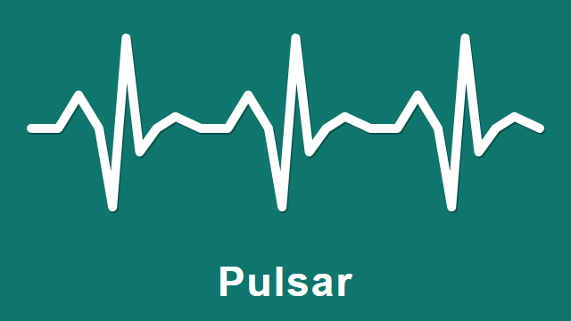

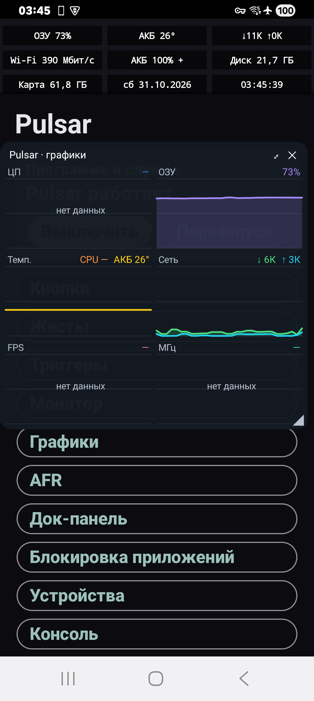 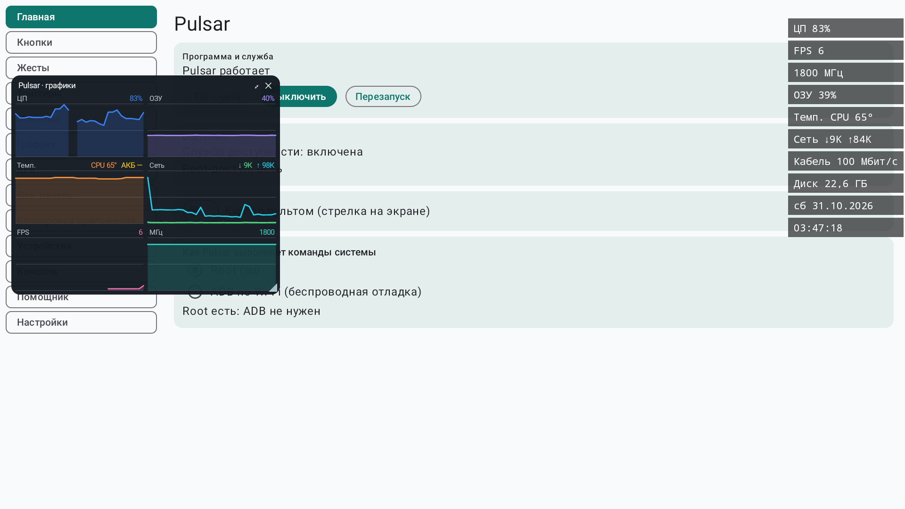

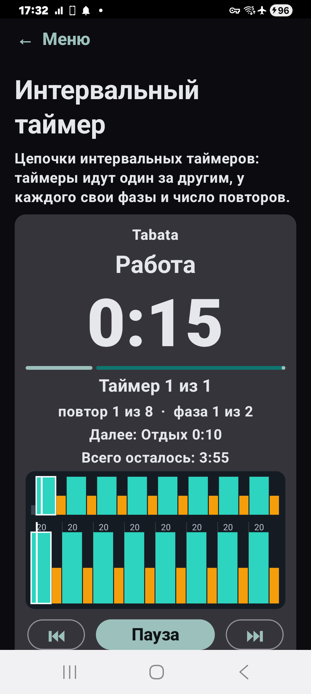 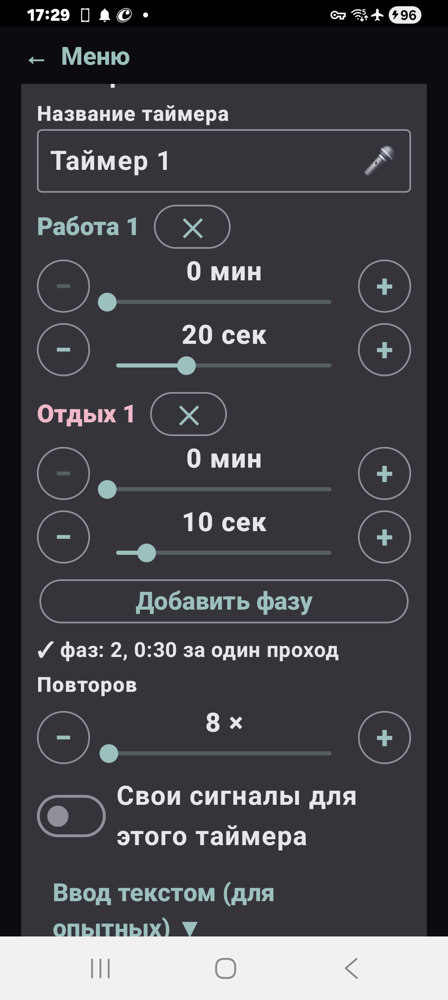 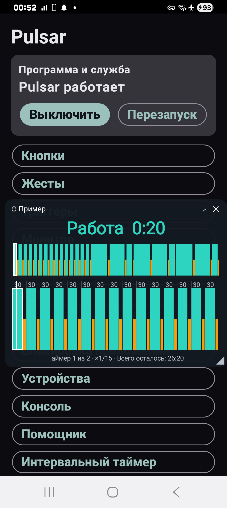 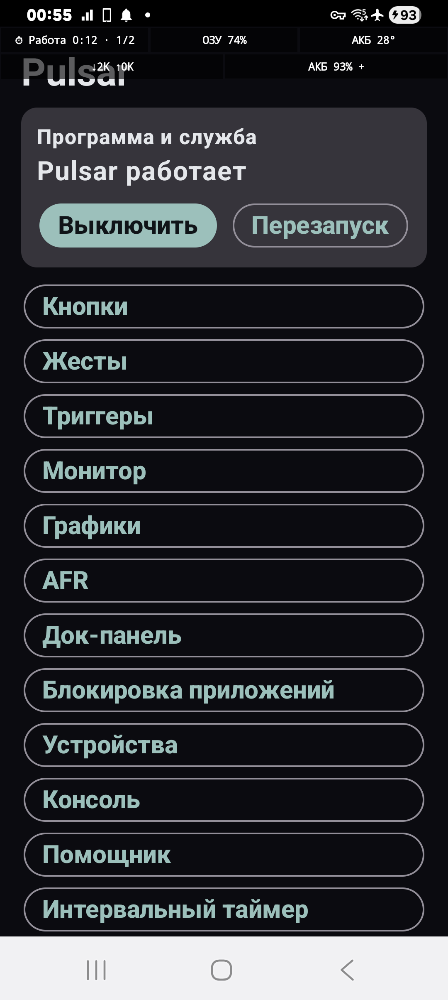

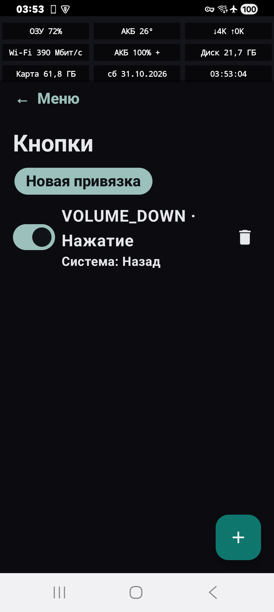 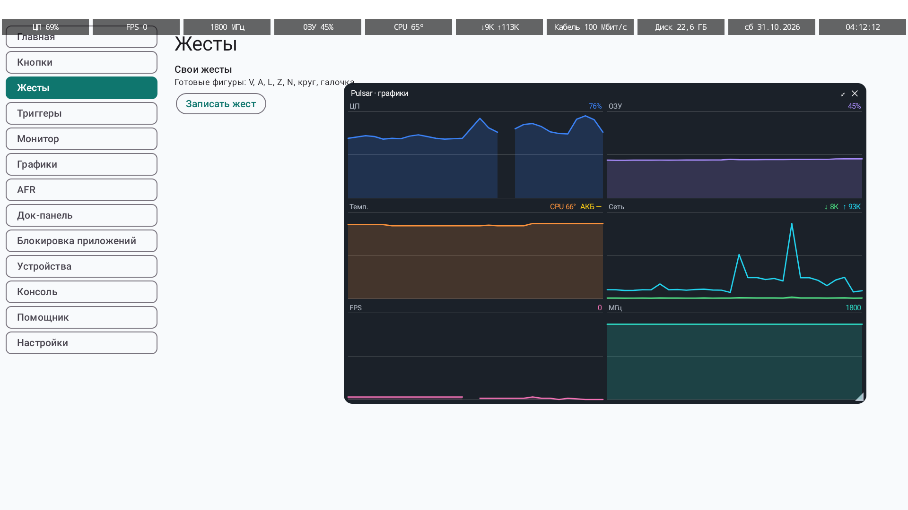 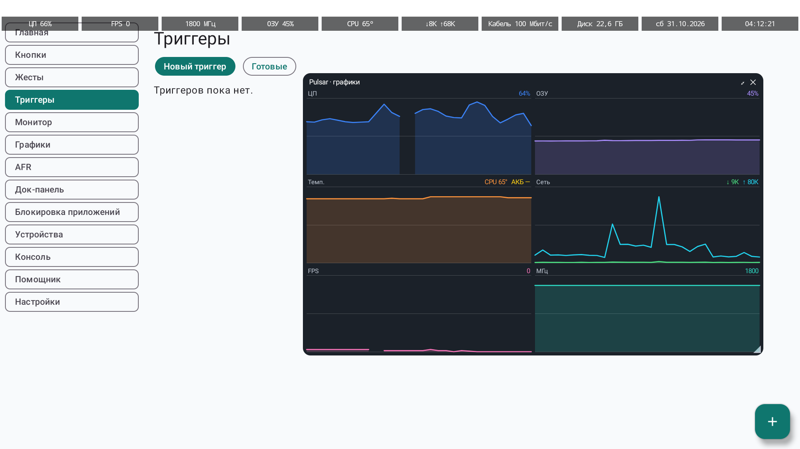 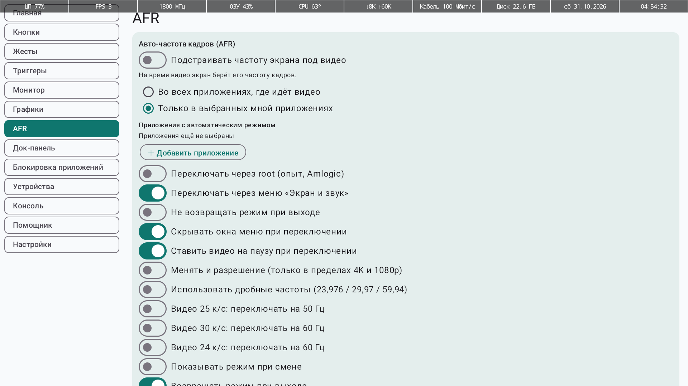 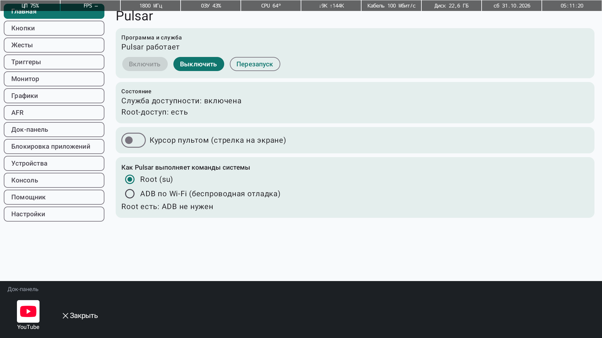 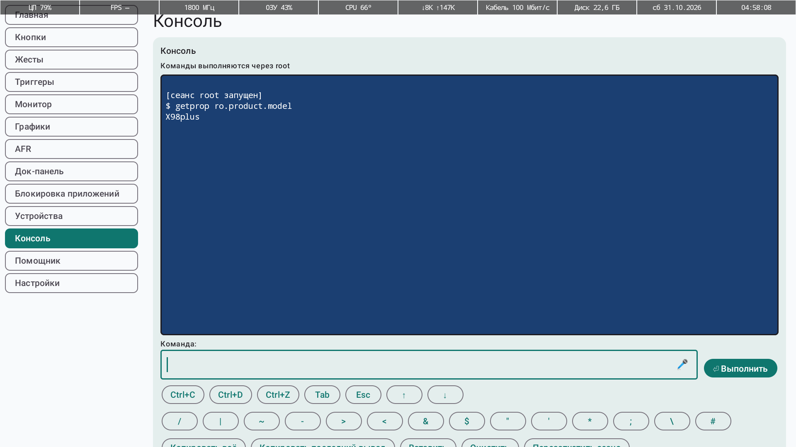

