[English](README.md) · [Русский](README.ru.md) · [Українська](README.uk.md)

# Pulsar

Пульс пристрою на екрані: плаваючий монітор навантаження і живі графіки в реальному часі, прив'язки кнопок пульта/клавіатури, жести, датчики, AFR, док-панель і помічник ШІ за бажанням — для телефонів і ТВ-приставок на Android.

Pulsar — це пульс пристрою на екрані: плаваючий монітор навантаження і живі графіки в реальному часі. А ще — кнопки пульта, жести, миша і датчики, перетворені на швидкі дії: відкрити застосунок, змінити гучність, перемкнути частоту екрана під відео і багато іншого. Працює і на телефоні, і на ТВ-приставці: пульт, жести, аеромиша. Реклами і покупок у програмі немає.

⭐ Якщо програма корисна, постав репозиторію зірку — це безкоштовно і допомагає іншим її знайти.

## Завантажити

**Версія 2.0.** [Pulsar-2.0.apk](https://github.com/drugoj00/pulsar/releases/latest) (Assets) · [Усі релізи](https://github.com/drugoj00/pulsar/releases)

SHA-256: `d508ab0a400ab6f4d741dcc2e101b715c3c4d45a7cc16808d130b9a4ed3b2b98`

У Google Play програми немає: завантажуй APK тут. Android може попередити про встановлення з невідомого джерела.

## Що нового в 2.0

- Вкладка **«Інтервальний таймер»**: ланцюжки таймерів, у кожного свої фази й повтори
- Звук раунду на вибір: гонг як у боксі, дзвін, свисток, біп або власний файл; регулятор гучності гонга
- Графік програми окремим вікном поверх екрана та плиткою в моніторі
- Продовжує працювати після перезавантаження пристрою
- Палиці за 10 с до кінця роботи, голосові підказки, екран не гасне
- У «Про програму»: посилання та блок «Підтримати»

## Можливості

- **Монітор.** Плаваюча панель з показниками (ЦП, ОЗП, температура, батарея, мережа, диск), будь-який кут екрана, рядком або стовпчиком, перетягується, свій колір і прозорість, не заходить на статусний рядок і кнопки/смугу навігації з будь-якого боку.
- **Графіки.** Окреме плаваюче вікно з живими графіками тих самих показників, рухається і змінює розмір.
- **Інтервальний таймер.** Ланцюжки таймерів: у кожного свої фази (робота, відпочинок…) і повтори, наприклад 30 с – 10 с × 15, потім 2:10 – 0:15 – 2:00 – 0:10 × 3. Звук початку й кінця раунду на вибір (за замовчуванням гонг як у боксі, дзвін, свисток, біп, власний файл), палиці за 10 с до кінця роботи, голосові підказки, вібрація, екран не гасне. Графік програми окремим вікном поверх екрана та плиткою в моніторі; після перезавантаження пристрою таймер продовжує працювати.
- **Кнопки.** Прив'язка одиночного, подвійного і довгого натискання будь-якої кнопки пульта, клавіатури, аеромиші або миші до дії: запуск застосунку, Додому, Назад, Останні, гучність, медіа-кнопки, макрос із кількох кроків, команда оболонки (root або ADB), TCP/HTTP-запит, знімок екрана, перезавантаження, блокування екрана та інше.
- **Жести.** Жести акселерометра (струсити, перевернути, нахилити, покрутити) працюють без root і ADB. Жести по екрану, аеромиша і миша (права/ліва кнопка затиснута + рух) — потрібен root або ADB.
- **Тригери.** Правила «подія → дія» (завантаження, бездіяльність заданий час, відкриття застосунку, вимкнення екрана), 25 готових шаблонів жестів і датчиків на вибір, поля редагуються перед збереженням.
- **AFR (автоналаштування частоти кадрів).** Екран сам перемикається на частоту кадрів відео, що йде, і повертається до попередньої після — для ТВ-приставок.
- **Док-панель.** Смуга обраних застосунків, сама слідує за екраном (видна над Pulsar і робочим столом, ховається в інших програмах), свій фон і прозорість, порядок і розташування значків, перестановка значків утриманням (миша/палець) або з пульта (утримання «ОК» і стрілки).
- **Блокування застосунків.** Вибрані застосунки відкриваються тільки за PIN-кодом (4–12 цифр).
- **Пристрої.** Підключення через root або бездротову відладку ADB (Android 11+), перепідключення саме.
- **Консоль.** Термінал із будь-якими командами оболонки прямо в програмі, введення голосом (мікрофон).
- **Помічник (ШІ, за бажанням).** «Придумати» — опиши словами, що має відбуватися, програма сама запропонує прив'язку або правило. «Пояснити» — встав готову технічну команду, програма розкаже, що вона робить (нічого не запускається). Працює офлайн на частих випадках; для решти — вибери сервіс і встав свій ключ (Claude, OpenAI, Gemini, DeepSeek, Groq, OpenRouter, Mistral — у Gemini, Groq, DeepSeek і OpenRouter є безкоштовний ліміт) або свій комп'ютер (Ollama / LM Studio) зовсім без ключа.
- **Захист від підробки.** Змінена і перепідписана чужим ключем копія сама вимикає частину функцій (обфускація + перевірка підпису під час запуску).
- **Журнал помилок.** Збої і невдалі прив'язки записуються самі; надсилання в підтримку — однією кнопкою, лист із файлом уже готовий.
- **Резервна копія.** Експорт та імпорт усіх налаштувань у файл.
- **Налаштування.** Тема (авто, світла, темна), мова (російська, українська, англійська).
- **Безкоштовно.** Без реклами.

## Потрібно

Android 7.0 і новіше. Працює і на телефонах, і на Android TV / ТВ-приставках (пульт, жести, аеромиша). Без root — бездротова відладка ADB (Android 11+) відкриває більшість можливостей; з root ADB не потрібен.

Перехоплювати натискання кнопок може тільки одна служба доступності одночасно. Якщо на пристрої вже стоїть інша програма для пульта/кнопок/жестів, система сама вирішує, яка з них отримує натискання — не завжди остання увімкнена. Якщо кнопки або жести не спрацьовують після встановлення Pulsar (або навпаки), відкрий Налаштування → Спеціальні можливості і вимкни одну з двох служб вручну.

## Скриншоти

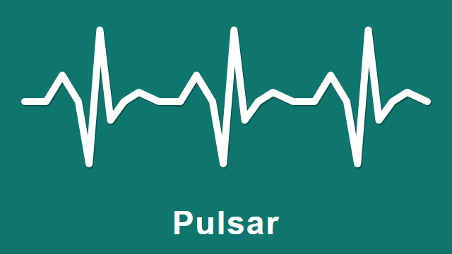

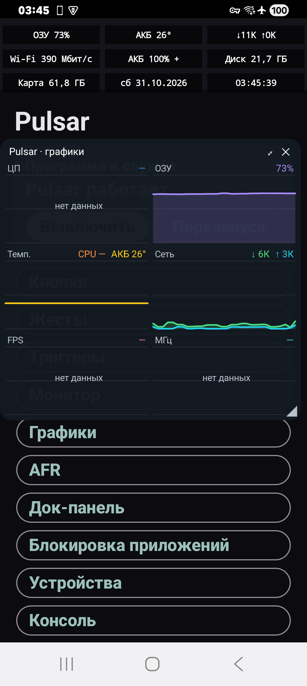 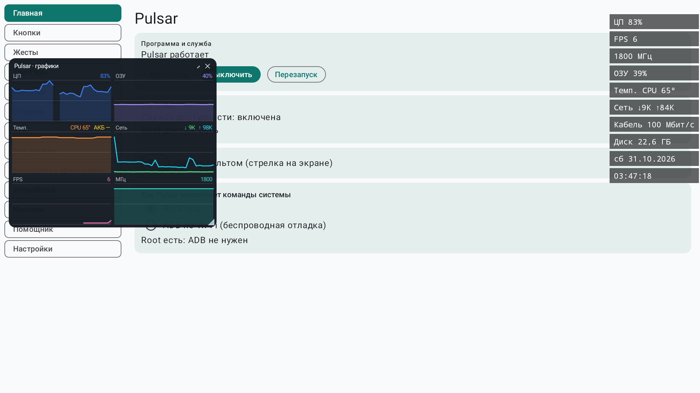

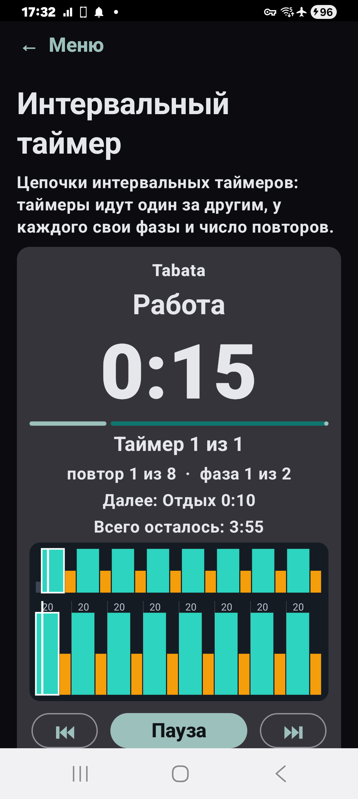 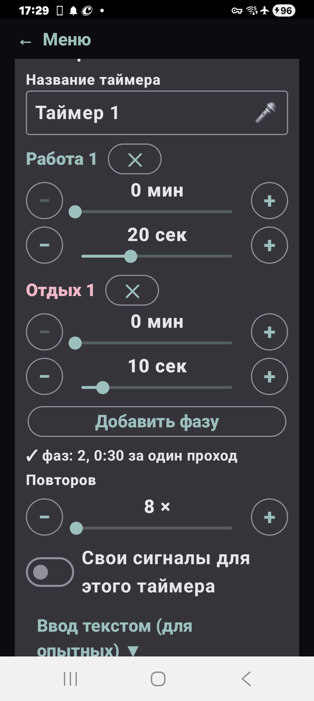 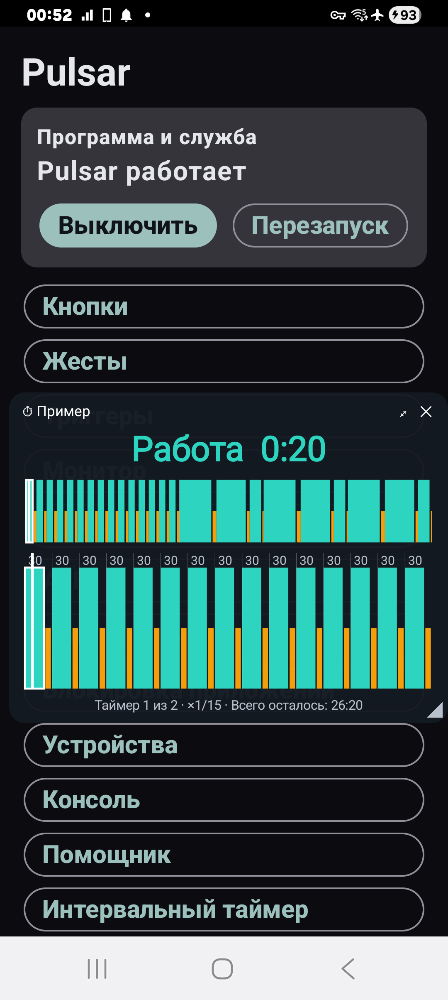 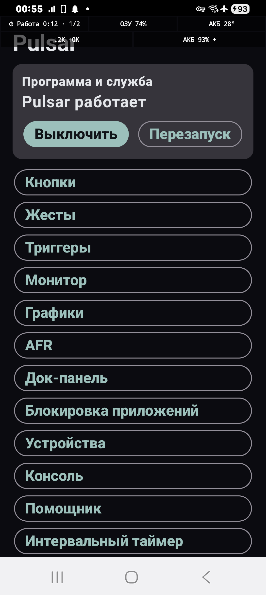

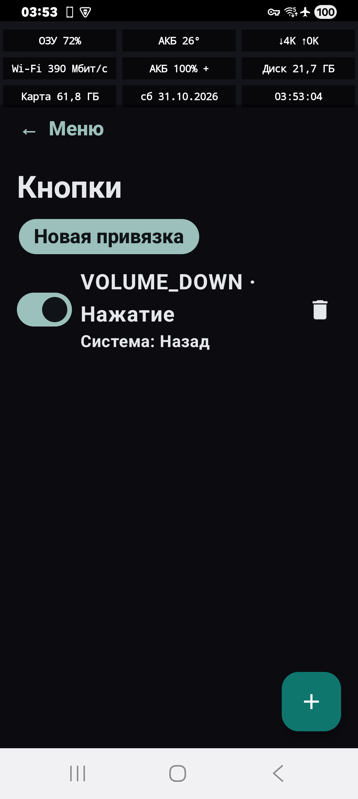 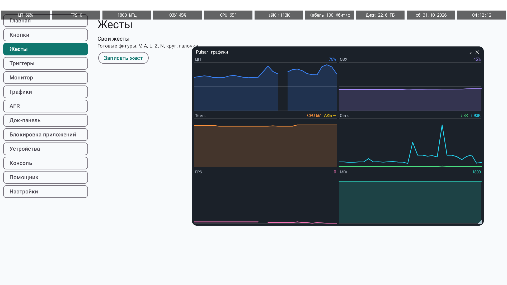 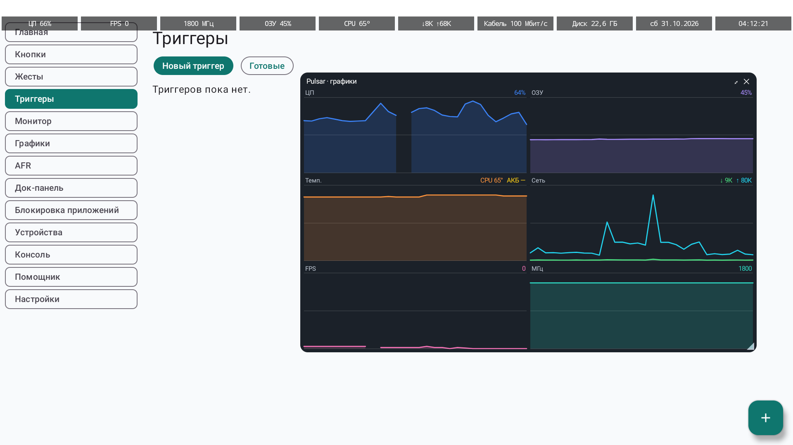 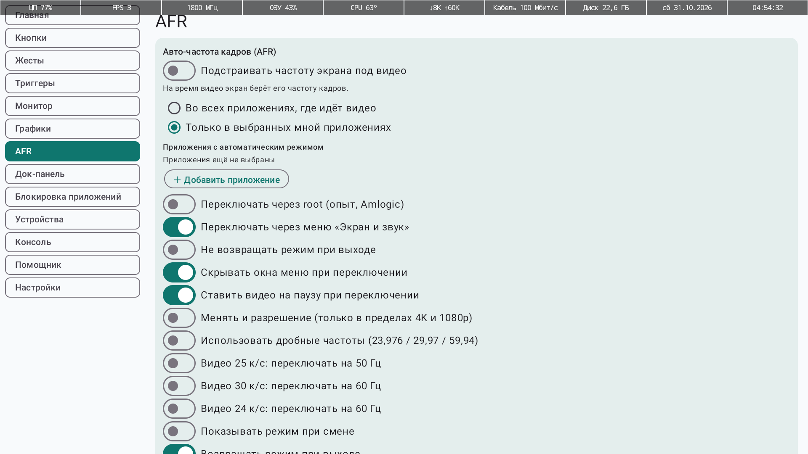 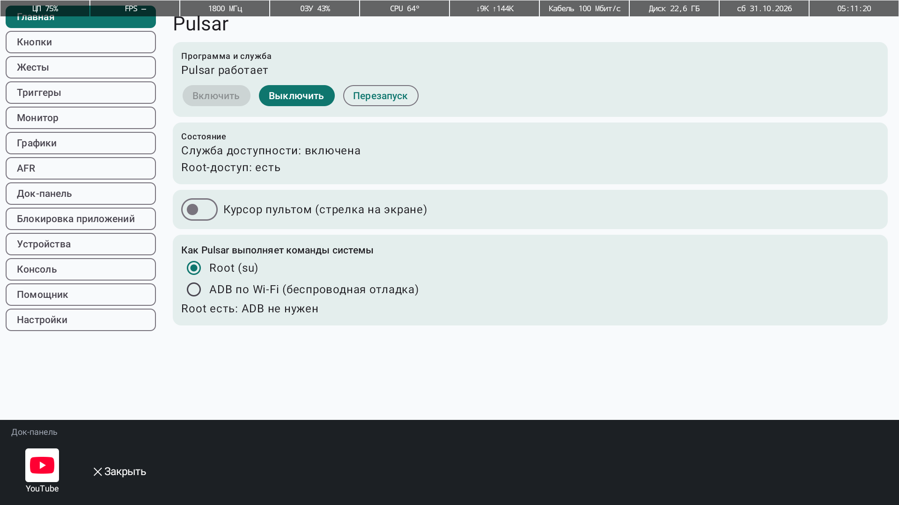 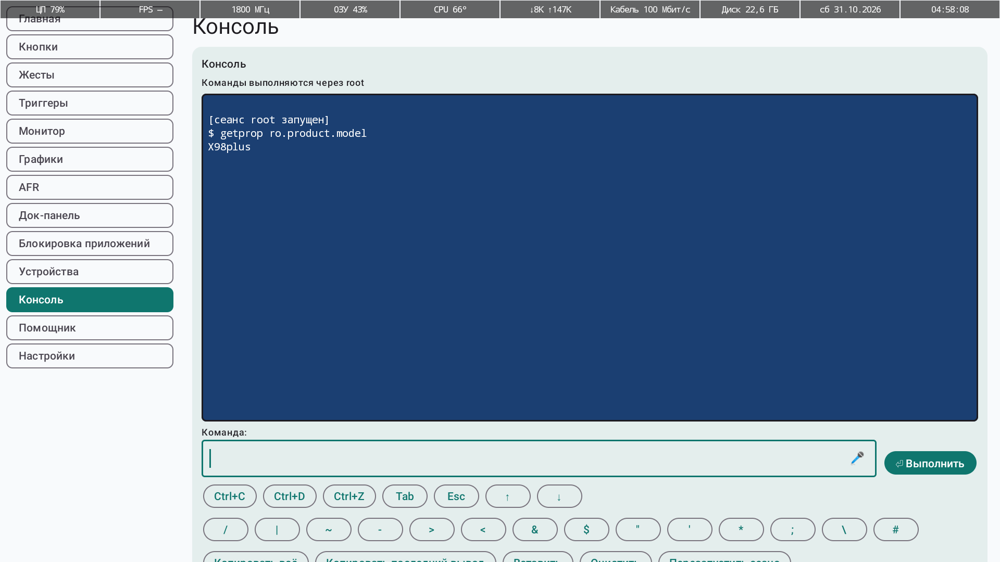

